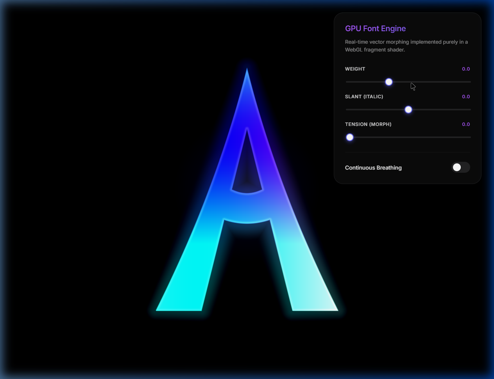

# GPU Font Engine (Real-Time Vector Morphing)

> A blazing fast, zero-dependency WebGL 2.0 demonstration of rendering and morphing complex vector shapes purely with mathematics in the fragment shader.



## Why This Exists

Traditional font rendering parses bezier curves on the CPU, triangulates them, and pushes vertices to the GPU. Or it relies on precomputed Signed Distance Field (SDF) texture atlases which lose infinite zoom clarity or take up valuable memory. 

Inspired by Eric Lengyel's brilliant **Slug** rendering algorithm, this project evaluates the mathematical equations of quadratic Bezier curves **natively in the fragment shader**. It mathematically determines the pixel boundary coverage using the standard `fwidth` derivative technique, meaning no textures, no triangulation preprocessing, and flawless visual fidelity at any scale.

## Features

- 🏎️ **Atlas-Free Rendering:** Mathematically exact curve distance roots (no precomputed SDF atlases — curve data rides in a tiny RGBA32F data texture, sidestepping fragment uniform limits and scaling to 1024 curves).
- 🧮 **Exact Vector AA:** Perfect anti-aliasing handled via analytic derivatives.
- 🔡 **Glyph Interpolation (Master Blending):** Morph between two arbitrary glyph outlines — the built-in pair, two typed font glyphs, or imported UFO masters. Contours are paired by area, curve counts equalized with *exact* de Casteljau subdivision (zero shape error at blend 0/1), orientation and ring phase aligned, and unmatched counters collapse to points. Every intermediate instance exports as a UFO .glif — a browser-native instance interpolator.
- 🧬 **Dynamic Structure Morphing:** Modulate Bezier anchor points dynamically at 60 FPS in pure JavaScript without triggering any expensive tessellation overhead.
- 🌬️ **Algorithmic Weight:** Inflate or deflate shapes simply by dynamically offsetting normals at runtime.
- ✂️ **Convex-Hull Culling:** Per-pixel bounding-box rejection skips the cubic root solve (and ray test) for curves that provably cannot affect the pixel.
- 🔁 **UFO Round-Trip:** .glif import honors UFO point types (including TrueType implied on-curve midpoints), so exported instances re-import losslessly.

## Quick Start

You don't need `npm`, `yarn`, or a heavy build pipeline. It's a single raw HTML/JS/WebGL native application.

1. Clone the repository.
2. Serve the directory with any local HTTP server:
   ```bash
   python -m http.server 10101
   # or
   npx http-server -p 10101
   ```
3. Open `http://localhost:10101` in your browser.

## Architecture

This project strictly follows the principle of providing geometry to the GPU in the rawest mathematical form:

### 1. The Geometry
A stylized letter "A" is constructed in `main.js` out of 10 contiguous Quadratic Bezier Curves (drop a `.ttf`/`.otf`/`.glif` to replace it — up to 1024 curves).
The JavaScript loop reads UI sliders and runs mathematical shifts (Glyph Morph lerps toward the target master, Tension drops peaks, Weight expands normal radii, Slant applies shear matrices), then packs the control points into a 1024×2 RGBA32F data texture on every `requestAnimationFrame` tick. A data texture (rather than uniform arrays) keeps the shader under the fragment-uniform limits of mobile and Apple GPUs.

### 1b. The Interpolation Compiler
Master blending needs both outlines to share one curve topology. When either master changes, a small compiler runs once (never per frame):

1. **Contour split:** each outline is cut into closed rings at positional discontinuities.
2. **Pairing:** rings are matched largest-area-first (outers to outers, counters to counters); a missing partner becomes a point-contour at its mate's centroid, so extra holes grow in or collapse out.
3. **Count equalization:** the shorter ring of each pair is subdivided with exact de Casteljau splits (longest segment first). Subdivision never moves the curve locus, so both masters still render *exactly* at blend 0 and 1 — this is interpolation between true outlines, not resamplings.
4. **Alignment:** rings are reversed to matching orientation, then cyclically rotated to the phase that minimizes squared start-point distance — preventing twisted morphs.

The render loop then lerps control points and the fragment shader evaluates the in-between glyph analytically. Any blend position can be exported as a UFO `.glif` instance.

### 2. The Fragment Engine
The WebGL fragment shader performs two critical mathematical functions simultaneously for every pixel:
1. **Ray Intersection Winding:** It casts an implicit ray across the Bezier formulas to determine if the pixel is functionally *Inside* or *Outside* the vector path using the Non-Zero winding rule.
2. **Shortest Unsigned Distance:** Using algebraic cubic root finding, it computes the exact mathematical distance to the closest Bezier limit for anti-aliasing bounds.

Before either evaluation, each curve is tested against the bounding box of its control points (the convex-hull property guarantees the curve stays inside it), so off-screen or distant curves cost almost nothing.

The values are mapped to `smoothstep(fwidth(signed), -fwidth(signed), signed)` to return perfectly anti-aliased sub-pixel pixel coverage geometry.

## Contributing

This is a proof-of-concept for real-time typeface manipulation geometry. If you want to replace the `basePoints` with a complete font interpreter or a TrueType-to-quadratic parser, pull requests are warmly welcomed!

## License

MIT © 2026 
